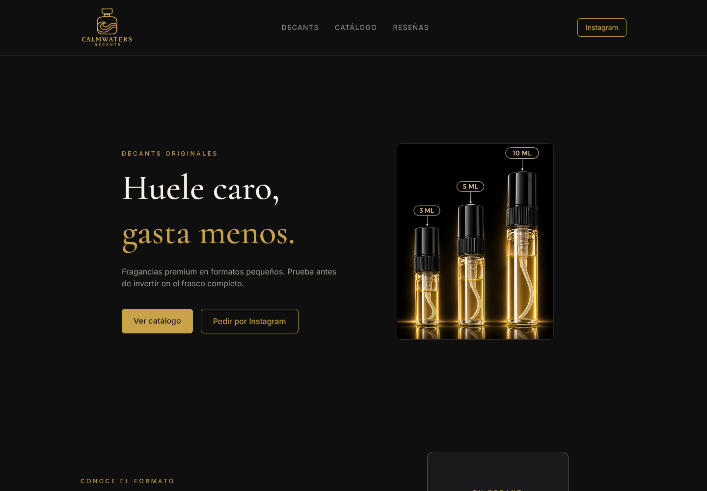
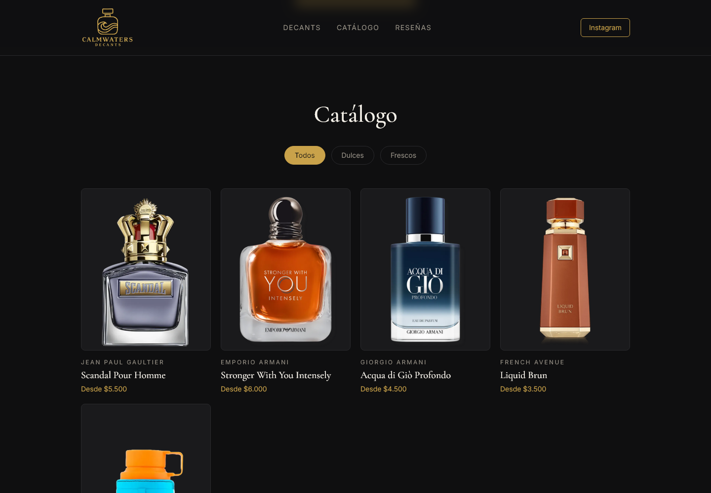
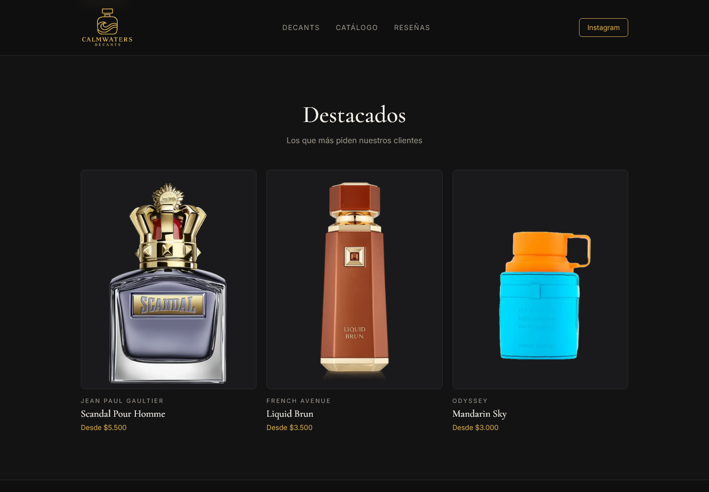

# Calmwaters Decants

Landing page para **calmwaters_decants**, una tienda de decants de perfumes originales. La experiencia ayuda a descubrir fragancias en formatos pequeños y facilita realizar pedidos por Instagram.

## Sitio en vivo

[Visitar Calmwaters Decants](https://calmwaters-decants.netlify.app/)

## Capturas

### Inicio



### Catálogo



### Perfumes destacados



## Funcionalidades

- Catálogo de perfumes con filtros dinámicos por familia.
- Fichas de producto con descripción, notas olfativas y acordes visuales.
- Selección de formato y precio antes de consultar por Instagram.
- Sección de perfumes destacados.
- Información sobre los formatos y sus atomizaciones aproximadas.
- Diseño adaptable a móviles y escritorio.

## Tecnologías

- React
- Vite
- Tailwind CSS
- Framer Motion

## Ejecutar en local

Necesitas Node.js y npm instalados.

```bash
npm install
npm run dev
```

Vite mostrará la dirección local en la terminal.

## Build de producción

```bash
npm run build
npm run preview
```

## Estructura

```text
src/
  assets/       Imágenes y recursos visuales
  components/   Secciones y componentes de la interfaz
  data/         Productos, formatos y contenido del sitio
  utils/        Funciones auxiliares
docs/
  screenshots/  Capturas incluidas en este README
public/         Recursos estáticos
```

## Enlaces

- [Instagram @calmwaters_decants](https://www.instagram.com/calmwaters_decants/)
- [Repositorio en GitHub](https://github.com/fatekiDev/calmwaters-decants)

## Autor

**Benjamin Concha · FatekiDev**
